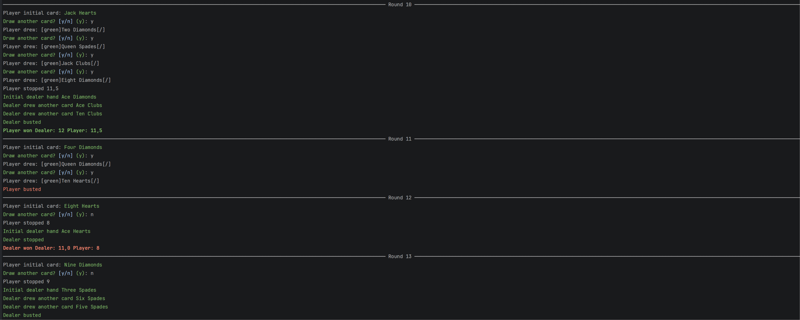

# Halvtolv — a Danish blackjack variant

Halvtolv is a Danish blackjack variant played with a standard 52-card deck. The goal is to get as close to **11½ points** as possible without going over. 

HalvTolv literally translated to HalfTwelve (11.5)

## About the sample

Play against a Jev-controlled dealer in an interactive console. The dealer uses
the supplied game rules, visible cards, and previous round statistics to choose
whether to stop or draw another card. Your first card is hidden from the dealer
while it decides, so it must reason with incomplete information.

The sample demonstrates passing structured game state to a `[JevQuery]`, defining
stop/continue choices with `GenericChoiceQuestionDefinition<string>`, and using
the generated typed response to drive gameplay.

## Screenshot



## Run

Install the .NET 11 SDK (currently in preview) and obtain a TypeSafe API key.
From the repository root, set the key and start the game in an interactive terminal.
The dealer sends requests to the live API, so internet access is required.

PowerShell:

```powershell
$env:JEV_TOKEN = "<your-typesafe-api-key>"
dotnet run --project Samples/BlackJack/BlackJack.csproj
```

Bash:

```bash
export JEV_TOKEN="<your-typesafe-api-key>"
dotnet run --project Samples/BlackJack/BlackJack.csproj
```

The sample reads **`JEV_TOKEN`**, not `TYPESAFE_API_KEY`, and does not provide an
`--api-key` option. Do not commit your key to source control. To run from an IDE,
open [Samples.slnx](../Samples.slnx), select `BlackJack` as the run project, and
set `JEV_TOKEN` in the run configuration's environment variables.

## Rules and background

- **Card values:** Cards 2–10 count at face value; jacks, queens, and kings count as ½ point each. Aces count as 1 or 11 and can change value as the hand develops to avoid going bust.
- **Play:** Each player starts with one card, then chooses to draw more cards (hit) or stop (stand). Exceeding 11½ means immediately losing the round.
- **Winning:** Once everyone has stood or gone bust, the highest total at or below 11½ wins. Players can compete against one another or against a designated banker. If everyone goes bust, nobody wins.
- **House rules:** An ace plus a face card makes a two-card 11½, called *født halvtolv* (a natural). Agree beforehand whether it beats an 11½ made with more cards, and how to handle ties or rounds where everyone goes bust. Dealer wins if both players have the same value

It was chosen because this because I played it with my grandmother a lot when I was a kid in in the end of the eighties/start of nineties. So both knowledge and experience played in.  

English summary adapted from [Netstjernen’s Danish Halvtolv rules](https://netstjernen.dk/spil/halvtolv/).
